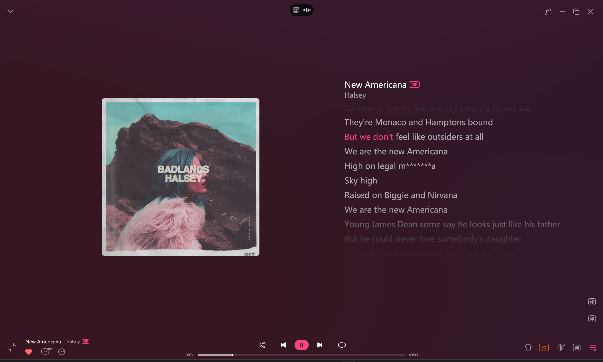
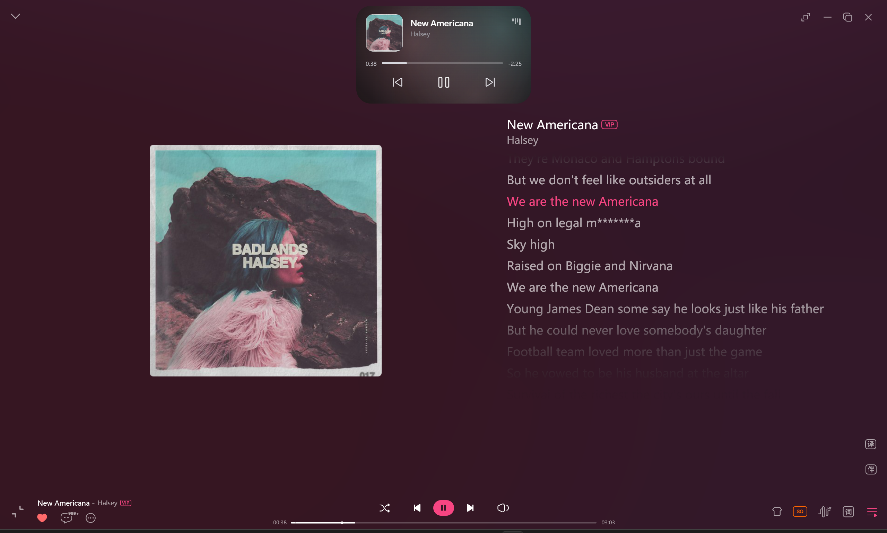

# WinIslandPlus

面向 Windows 11 的「灵动岛」桌面小工具，用 **Tauri 2（Rust + WebView2）** 实现：
透明置顶的岛体窗口 + WebView2 里的像素级动效，Rust 侧负责媒体、窗口系统与系统集成。

检测到系统媒体播放时，屏幕顶部居中会出现一个黑色胶囊小岛；点击后以缓动动画展开为
媒体控制卡片。可以切换尺寸与落位预设，也可以开启「常驻」在没有媒体时保持一个静止胶囊。
岛体平时位置锁定，只有在设置窗口打开期间才能拖动调整。

媒体与 DeepSeek Harness 是**两个彼此独立的岛**：两者都在时，胶囊行左边是 dsh 胶囊、
右边是纯黑正圆岛（圆内是一枚圆角矩形专辑图，没有封面时显示居中的频谱）；
展开时一次只展开一个，卡片长在胶囊行的下一行，切换展开对象时两个岛各自补间、
只做上下换位，胶囊行只剩媒体时它会变回平时的胶囊形态。

<p align="center">
  
  
</p>

## 功能

- **媒体感知**：通过系统 SMTC（`GlobalSystemMediaTransportControlsSessionManager`）读取任意播放器的
  标题 / 艺术家 / 封面 / 播放进度，无需任何权限，也不依赖特定播放器。
- **胶囊态**：近纯黑胶囊，宽高固定 2:1（中档 68×34 DIP），左侧微缩封面、右侧跳动的音柱；
  播放中跳动，暂停时静止；没有封面时封面让位、频谱在胶囊里居中；无媒体时自动隐藏
  （除非开启常驻）。dsh 同时在运行时媒体岛收成纯黑正圆（直径 = 胶囊高度），圆内嵌一枚
  圆角矩形专辑图（四周留黑边，不铺满），与左侧的 dsh 胶囊并排居中；没有封面时圆内显示频谱。
  dsh 卡片展开、胶囊行只剩媒体时，它会变回普通胶囊形态。
- **展开态**：336×188 DIP 的黑色圆角卡片（约 1.8:1），左侧大封面，右侧标题 / 艺术家与均衡器指示，
  下面是「已播时间 · 进度条 · 剩余时间」，最底部为上一首 / 播放暂停 / 下一首的纯图标按钮。
  卡片长在胶囊行的下一行（贴底时镜像到上一行），另一个岛留在胶囊行并居中；
  展开 / 收起为 300 / 240 ms 的缓动动画，位置 / 尺寸 / 圆角同步插值。
  展开期间胶囊行整条仍属于岛体（点击行内空白处即收起），不会被判成"岛外"而穿透到下面的窗口。
- **位置锁定**：岛体平时不可拖动（点击即展开 / 收起），只有在设置窗口打开期间才能拖动调整。
- **位置与尺寸**：顶部居中（默认）、顶部左 / 右、底部居中四种预设 + 自定义拖动落位；
  小 / 中 / 大 / 自定义四档尺寸（自定义只调宽度，高度恒为宽度的一半）。
- **DeepSeek Harness 适配**：只要 dsh 桌面端 / CLI 在运行就自动接入，dsh 胶囊上直接显示
  当前阶段、会话 token 与官方余额；展开后是一张独立的信息卡（图标 + 阶段 + 当前工具名 +
  token / 成本 / 余额 / 模型），不再附在媒体控件下方。没有媒体时 dsh 岛单独居中，
  两者都在时 dsh 在左、媒体正圆在右；dsh 展开时媒体回到居中的普通胶囊。
  阶段来自 dsh 会话事件流的尾部帧（只解最后一个 zstd 帧，不读对话正文），
  详见 [docs/dsh-status.md](docs/dsh-status.md)；`scripts/dsh-status.ps1` 是可选的
  状态文件写入器，用于补充会话成本或自定义文案。
- **右键屏蔽**：胶囊态、展开态与设置窗口都吞掉右键上下文菜单，右键不会弹出任何卡片。
- **常驻模式**：没有媒体时也显示一个静止的空胶囊，且点击不展开。
- **托盘菜单**：显示 / 隐藏、位置、尺寸、常驻、开机自启、设置、退出。
- **设置窗口**：分组的 Fluent 设置界面（自绘 ComboBox / ToggleSwitch / Slider），改动即时预览，
  「取消」可回滚。
- **开机自启**：写入 `HKCU\...\Run`，不需要管理员权限。
- **单实例**：重复启动不会多开，而是唤出已有实例的设置窗口。

## 环境要求

- Windows 11（22H2 及以上，需要 `Windows.Media.Control`）
- Rust 1.85+：`winget install Rustlang.Rustup`
- Node.js 20+ 与 pnpm：`winget install OpenJS.NodeJS.LTS` + `npm i -g pnpm`
- WebView2 Runtime（Win11 自带）

## 构建与运行

```powershell
# 安装前端依赖
pnpm install

# 开发运行（Vite 热更新 + Tauri 窗口）
powershell -ExecutionPolicy Bypass -File scripts\run-dev.ps1

# 构建并打包（产物复制到 release\）
powershell -ExecutionPolicy Bypass -File scripts\build-release.ps1
```

> 直接用 `cargo build` 得到的是「开发模式」可执行文件，它会去连 `http://localhost:1420`；
> 需要独立运行请用 `pnpm tauri build`（或上面的脚本），它会把 `dist/` 内嵌进可执行文件。

## 安装到系统 / 卸载

```powershell
# 复制到 %LOCALAPPDATA%\Programs\WinIslandPlus，创建开始菜单快捷方式并启动
powershell -ExecutionPolicy Bypass -File scripts\install.ps1

# 同时注册开机自启
powershell -ExecutionPolicy Bypass -File scripts\install.ps1 -AutoStart

# 卸载（默认保留配置与日志）
powershell -ExecutionPolicy Bypass -File scripts\uninstall.ps1
powershell -ExecutionPolicy Bypass -File scripts\uninstall.ps1 -RemoveSettings
```

## 打正式安装包

`scripts\build-release.ps1` 会调用 `pnpm tauri build`，产出：

- `release\WinIslandPlus_<版本>_x64-setup.exe`：NSIS 单文件安装包，**无需管理员权限**，
  装到 `%LOCALAPPDATA%\Programs\WinIslandPlus`，自带开始菜单快捷方式；
- `release\win-island-plus.exe`：免安装的绿色版可执行文件。

版本号的唯一来源是 `src-tauri/tauri.conf.json` 的 `version`（与 `src-tauri/Cargo.toml` 保持一致）。

安装向导为**英文 + 简体中文**双语：启动时弹出语言选择框，可选语言由
`src-tauri/tauri.conf.json` 的 `bundle.windows.nsis.languages` 指定。

> 托盘图标默认会落在任务栏的「隐藏的图标」溢出区，
> 可在 设置 → 个性化 → 任务栏 → 其他系统托盘图标 中把它固定到任务栏。

## 使用

| 操作 | 效果 |
| --- | --- |
| 单击媒体胶囊 / 圆形专辑图 | 展开为媒体卡片（dsh 岛留在胶囊行居中） |
| 单击 dsh 胶囊 | 展开为 dsh 信息卡（媒体岛退回胶囊行） |
| 另一个岛已展开时单击它 | 直接换位展开，不需要先收起 |
| 再次单击已展开的岛 / 点击屏幕任意其它位置 | 收起为胶囊 |
| 光标离开（默认 2.5 秒，可在设置里改时长或关掉） | 收起为胶囊 |
| 设置窗口打开期间按住岛体拖动 | 移动岛体位置（超过 6 DIP 位移才算拖动，松手保存并锁定） |
| 托盘图标左键 | 显示 / 隐藏岛体 |
| 托盘图标右键 | 位置、尺寸、常驻、自启、设置、退出 |
| 常驻 + 无媒体 | 显示静止空胶囊，点击无反应 |

岛体是置顶且不抢焦点的窗口：点击它不会把你当前正在编辑的窗口切走，胶囊圆角之外的区域
也点得到下方的窗口。

## 配置

配置文件：`%LOCALAPPDATA%\WinIslandPlus\settings.json`（原子写入，损坏时自动备份并回落到默认值）。

| 字段 | 说明 |
| --- | --- |
| `Placement` | `TopCenter` / `TopLeft` / `TopRight` / `BottomCenter` / `Custom` |
| `AnchorXRatio`、`AnchorYRatio` | 自由落位锚点（相对显示器工作区的比例） |
| `BottomAnchored` | `true` 表示以锚点下沿为基准向上生长 |
| `Size` | `Small` / `Medium` / `Large` / `Custom` |
| `CustomPillWidth`、`CustomPillHeight` | 自定义胶囊宽度（DIP，60–96），高度恒为宽度的一半 |
| `Persistent` | 常驻模式 |
| `AutoStart` | 开机自启状态（与注册表联动） |
| `AutoCollapseOnPause` | 播放暂停时自动收起 |
| `IdleCollapse` | 光标离开岛体后是否自动收起 |
| `IdleCollapseSeconds` | 光标离开多久后自动收起（秒，1–15） |
| `DshEnabled` | 是否接入 DeepSeek Harness 状态（默认 `true`） |

日志：`%LOCALAPPDATA%\WinIslandPlus\logs\app-yyyyMMdd.log`（只记录异常与状态迁移，不记录媒体内容）。

## 目录结构

```
island.html / settings.html        两个窗口入口（Vite 多页面）
src/
  common/                          契约类型、尺寸几何、主题常量、IPC 封装、时间格式
  island/                          岛体窗口：双岛布局引擎、缓动、胶囊 / 卡片 / 光晕 / 进度条
  settings/                        设置窗口：Fluent 自绘控件与业务逻辑
  styles/tokens.css                Fluent 颜色令牌（浅 / 深色）
src-tauri/
  src/main.rs lib.rs               启动编排：日志 → 配置 → 单实例 → 岛窗样式 → 媒体 → 托盘 → 轮询器
  src/commands.rs                  IPC 入口
  src/state.rs                     共享运行时状态（设置 / 形状 / 展开态 / 锚点）
  src/window.rs placement.rs       Win32 悬浮窗技巧与落位解算
  src/poller.rs                    光标轮询：点击穿透、自动收起、拖动岛体、置顶心跳
  src/media/                       SMTC 会话、封面解码、取色、LRU 缓存
  src/dsh/mod.rs                   DeepSeek Harness 状态文件轮询与快照推送
  src/settings.rs startup.rs       配置原子读写、HKCU 自启
  src/tray.rs                      运行时绘制托盘图标 + 原生菜单
docs/dsh-status.md                 dsh 状态文件契约与接入说明
scripts/                           开发运行、打包、安装卸载、图标生成、截图与诊断
release/                           交付产物（安装包与绿色版 exe）
```

## 实现要点与已知限制

- **透明与形状**：窗口 `transparent: true` + 无边框 + 无阴影 + DWM 边框色为「不绘制」
  （`DWMWA_COLOR_NONE`），圆角由 CSS `border-radius` 在合成层做逐像素 alpha，边缘带抗锯齿，
  不会出现任何描边、暗环或贴边渐晕。
- **形状外点击穿透**：窗口本身是矩形，Rust 侧 ~16 ms 轮询 `GetCursorPos`，按当前可见的
  两块形状（媒体岛 + dsh 岛，各自圆角矩形）做「任一命中」判定后**边沿触发**
  `WS_EX_TRANSPARENT`，因此四角透明区域与两岛之间的空隙的点击都会落到下方窗口。
- **不抢焦点**：岛窗带 `WS_EX_NOACTIVATE | WS_EX_TOOLWINDOW`，并在 `WM_MOUSEACTIVATE`
  返回 `MA_NOACTIVATE`。WebView2 在未激活窗口上仍会派发指针事件，所以卡片按钮用标准
  DOM 事件；而进度条拖动、岛外点击收起、拖动岛体统一走 Rust 轮询，不依赖事件可靠性。
- **窗口尺寸固定**：窗口始终按「胶囊行 + 8 DIP 间距 + 卡片行」创建，展开 / 收起只改变内部
  两块岛面的宽高 / 位置 / 圆角，不会出现「窗口先放大、内容后跟上」的空白帧。
- **双岛补间**：两个岛面各持一条 `GeometryTween`，由同一条 rAF 帧循环驱动（同一时间戳、
  形状只推一次）。切换展开对象时两个岛在同一帧里各自补间，因此是「一收一展」的换位，
  而不是两段动画。胶囊宽度按 dsh 内容自适应（96–132 DIP，先量再写，避免逐帧测量）。
- **dsh 状态时效**：阶段与用量只在会话确实活跃时展示——空闲态只显示阶段与余额，
  避免把上一个会话的 token 数挂在当前空对话上。
- **置顶保活**：轮询器每 2 秒检查一次 `WS_EX_TOPMOST`，丢失即重新压顶；同时兜底
  「应该显示却被隐藏」的情况。
- **取色光晕**：封面在 Rust 侧解码 32×32 后按色相分桶提取主 / 次色；展开卡片背后三团
  同源光斑**铺满整张卡片**，播放时缓慢漂移 + 呼吸，暂停时完全静止。未展开的胶囊态不显示光晕，
  保证平时仍是一枚干净的纯黑胶囊。
- **材质**：黑色底带一点点透明度（`rgba(11,11,12,0.95)`），能隐约透出桌面，但整体仍是
  深色不透明的"黑玻璃"观感；没有任何边框、描边或贴边渐暗，圆角边缘直接由逐像素 alpha 收边。
- **媒体控制能力取决于播放器**：只提供上一首 / 暂停 / 下一首 / 跳转，
  播放器不支持的操作（如直播流的跳转）会被静默忽略。
- **仅支持 Windows 11**：依赖 Win11 的 DWM 行为与 `Windows.Media.Control`。

## 许可证

本项目基于 [Apache License 2.0](LICENSE) 发布，Copyright 2026 Glassous。

第三方依赖遵循各自许可证：[Tauri](https://github.com/tauri-apps/tauri)（MIT/Apache-2.0）、
[windows-rs](https://github.com/microsoft/windows-rs)（MIT/Apache-2.0）、
[image](https://github.com/image-rs/image)（MIT/Apache-2.0）、
[winreg](https://github.com/gentoo90/winreg-rs)（MIT）。
